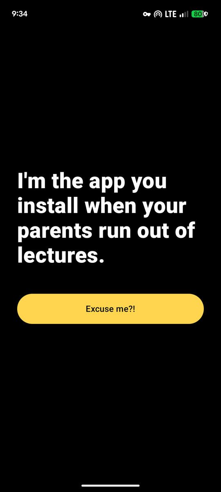
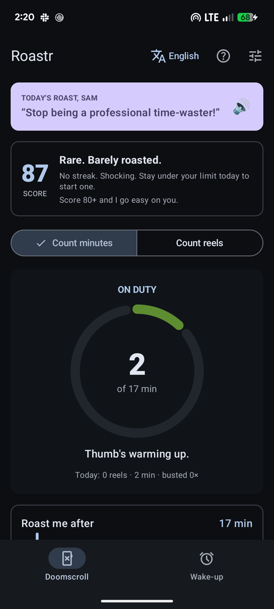
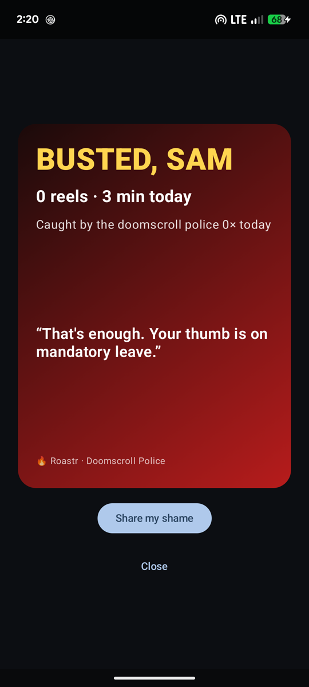
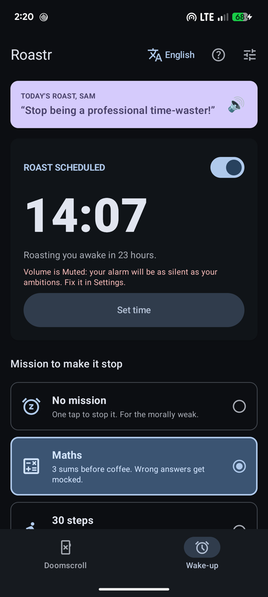
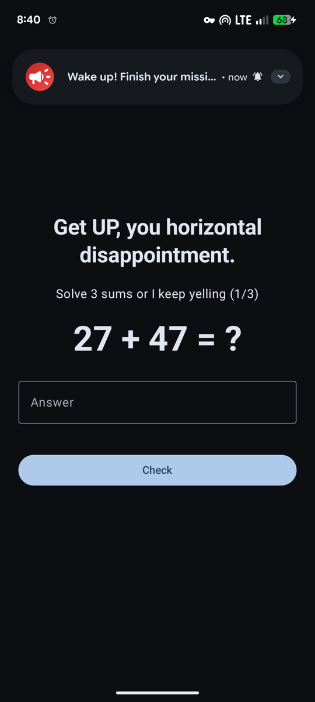

<div align="center">


# Roastr

**The app that roasts you off your phone.**

Your screen time report is too polite. Roastr is not.<br>
Doomscroll past your limit and it roasts you, out loud, until you put the phone down.

[](https://github.com/joshipraneel/roastr/releases/latest/download/roastr.apk)
[](https://joshipraneel.github.io/roastr/)


</div>

<p align="center">
  
  
  
  
  
</p>

> *"The reels will be there tomorrow. Stop."*
> &nbsp;&nbsp;&nbsp;&nbsp;— Roastr, to you, at 2 a.m.

## What it does

| | |
|---|---|
| 🚓 **Doomscroll police** | Set a daily limit for YouTube and Instagram. Pass it and you get roasted, again every five minutes you stay. |
| 🔥 **Reel counter** *(optional)* | Counts every Short and Reel you swipe. A pill in the corner goes green, yellow, red. At the limit, you're sent to the home screen. |
| ⏰ **Wake-up roast** | An alarm that yells you out of bed. Make it stop with three maths sums or 30 real steps. Snoozing is not a mission. |
| 📈 **Score and streak** | A daily score out of 100. Stay under your limit and finish your wake-up mission. Score 80+ and the roasts go easy on you. |
| 🪪 **Shame card** | Today's numbers and a fresh roast, ready to share. Plus a weekly summary with the title you earned. |
| 🗣️ **Four languages** | English, हिंदी, मराठी and ಕನ್ನಡ, with nearly 1,000 voiced lines. Three spice levels, from grandma-safe to savage, all jokes, no slurs. Or record your own. |

## Private by design

- **No internet.** Roastr doesn't have network permission. Nothing you do leaves your phone.
- **No account, no ads, no analytics.**
- **Minutes mode** only sees how long YouTube and Instagram were open, through Android's Usage Access.
- **Reel mode** uses an Accessibility service that only listens to YouTube and Instagram and only counts swipes. It asks for consent first and never reads what you watch, type or message.
- **Delete everything** by uninstalling or clearing the app's storage.

Read the full [privacy policy](https://joshipraneel.github.io/roastr/privacy/).

## Install

1. Download **[roastr.apk](https://github.com/joshipraneel/roastr/releases/latest/download/roastr.apk)** on your Android phone (Android 12 or newer).
2. Open it. If Android asks, allow your browser to install apps.
3. Open Roastr and let it insult you through setup.

To update, install the newer APK from [Releases](https://github.com/joshipraneel/roastr/releases) over the old one. Your stats are kept.

**On Android 14 or newer**, open the Wake-up page once after setting an alarm. If Android is blocking full-screen alarms, Roastr shows an **Allow full-screen alarm** button. Without it, the alarm is just a notification you can swipe away.

**Check the download (optional).** Every release is signed with the same key. Its SHA-256 certificate fingerprint is:

```
00:7b:29:70:3e:9b:72:d5:a1:a0:f0:5c:92:47:e1:f3:ac:4c:b2:f9:6b:48:fd:ea:ce:90:a3:61:0f:79:43:40
```

## Permissions, and why

| Permission | Why |
|---|---|
| Usage access | Count today's minutes in YouTube and Instagram (minutes mode). |
| Accessibility *(optional)* | Count reel swipes and send you home at the limit (reel mode). |
| Notifications | Tell you when you're busted and show the alarm. |
| Alarms and full-screen | Ring on time and show the wake-up mission over the lock screen. Android 14+ may need you to allow full-screen alarms; the Wake-up page tells you if so. |
| Physical activity *(optional)* | Count steps for the 30-step mission. |
| Microphone *(optional)* | Record your own roasts. |

## What's new in 1.0

- First public release.
- Two pages: **Doomscroll** (score, streak, limit, week chart) and **Wake-up** (alarm and missions).
- First launch opens with a roast, then sets you up: name, language, spice level, permissions.
- The maths mission's keyboard ✓ now submits your answer, and **Check** stays visible above the keyboard.
- The Wake-up page warns you when Android 14+ blocks full-screen alarms, with a button to fix it.
- 150 new roast lines with voice: 60 in English and 30 each in हिंदी, मराठी and ಕನ್ನಡ.
- Every roast reworked to be a joke, not abuse: no hard swearing, slurs or family insults, even at 18+.

## FAQ

**Is it on Google Play?** Not yet. It's coming. Until then, grab the APK here.

**Why is it so rude?** Because polite screen-time reminders are easy to ignore. Pick *Mild* if you want it clean.

**My roast didn't play.** Roasts use the alarm volume. Check the volume slider in Roastr's settings and your phone's alarm volume.

**The alarm showed up as a notification instead of taking over the screen.** Android 14+ turned off full-screen alarms for Roastr. Open the Wake-up page and tap **Allow full-screen alarm**.

**Found a bug, or a roast that's too much?** [Open an issue](https://github.com/joshipraneel/roastr/issues).

---

<div align="center">
<sub>Roastr is for adults (18+). The roasts are rude; that's the point. · © 2026 @joshipraneel · All rights reserved.</sub>
</div>
